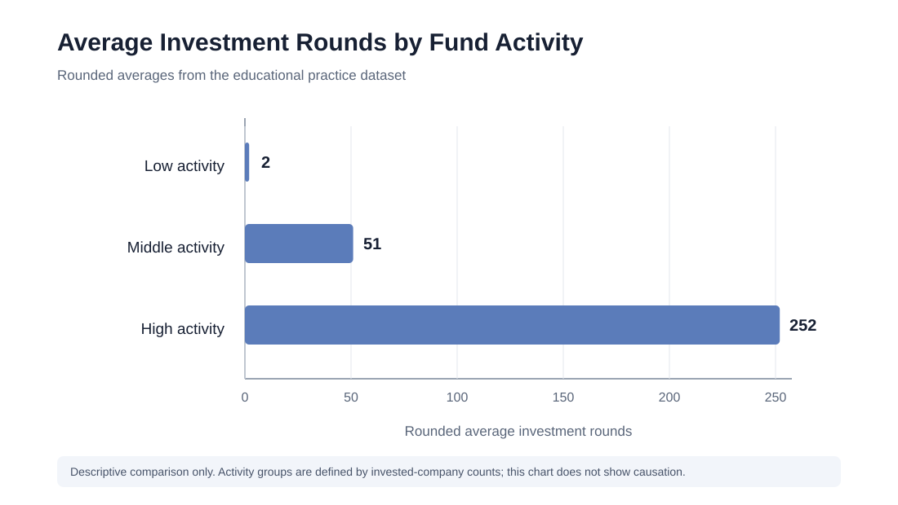

# Exploring Startup Trends with SQL

## Project overview

This project explores a venture-capital and startup database to answer questions about company closures, funding patterns, acquisitions, influential people, geographic investment, fund activity, and employee education.

The queries demonstrate filtering, sorting, aggregation, grouping, conditional logic with `CASE`, pattern matching with `LIKE`, joins, and nested subqueries.

> **Project context:** An analysis of a venture-capital and startup dataset covering funding, closures, acquisitions, and fund activity. Figures describe this dataset and are not current market statistics.

## Visual summary

See the [chart source](charts/average_investment_rounds_by_activity.svg) and [analysis results](ANALYSIS_RESULTS.md) for the results, interpretations, and limitations.

## Key findings

- **2,584** companies were marked as closed in the dataset.
- The largest displayed funding total among U.S. news-category companies was **$622.553 million**.
- The summed cash acquisition price for 2011–2013 was approximately **$137.762 billion**, based on the selected records.
- The United States had the largest summed company funding total by country at approximately **$310.588 billion**.
- The funding-round date analysis includes large differences between the minimum and maximum amounts recorded on the same date.
- Rounded average investment-round values were **2** for low-activity funds, **51** for middle-activity funds, and **252** for high-activity funds.
- The selected education-record analysis returned an average of approximately **1.23113** recorded degree entries per person.

All values above are descriptive outputs from the dataset. See [Analysis Results and Key Findings](ANALYSIS_RESULTS.md) for context and caveats, including the distinction between a highest individual-company funding value and a sector-wide total.

## Questions explored

1. **Startup landscape:** Count companies marked as closed.
2. **Sector analysis:** Retrieve funding totals for U.S. news companies, ordered from highest to lowest.
3. **Cash acquisitions:** Sum cash acquisition prices from 2011 through 2013.
4. **Industry influencers:** Find people whose Twitter usernames begin with `Silver`.
5. **Finance influencers:** Find people whose Twitter usernames contain `money` and whose last names begin with `K`.
6. **Geographic investment:** Sum company funding by country and rank countries by total.
7. **Funding-round variation:** Compare minimum and maximum amounts raised on each funding date, excluding zero minimums and dates with identical amounts.
8. **Fund activity:** Classify funds as high, middle, or low activity by number of companies invested in.
9. **Investment strategy:** Compare average investment rounds across fund-activity categories.
10. **Education and startup outcomes:** Calculate the average number of recorded degree entries for people associated with companies selected by the query's closed-company and funding-round filters.

## Repository structure

- `sql/` — ten queries organized by analysis question.
- `schema/database_schema.md` — notes on the tables and relationships shown in the project ERD.
- `ANALYSIS_RESULTS.md` — results, interpretations, and limitations.

## SQL concepts demonstrated

- `SELECT`, `WHERE`, `ORDER BY`
- Aggregate functions: `COUNT`, `SUM`, `MIN`, `MAX`, `AVG`
- `GROUP BY` and `HAVING`
- `CASE` expressions and `ROUND`
- `LIKE` pattern matching
- `JOIN` operations and nested subqueries

## Interpretation notes

- These scripts use the dataset’s original field names and structure.
- Results can vary if the underlying database changes.
- Query 10 measures recorded education entries per person in the selected subset; it does not establish that education causes startup success.
- Monetary interpretations assume the source values are denominated in U.S. dollars, consistent with the dataset documentation.
- Run these scripts against the matching project database/schema. They do not create the source tables.

## Author

Clement Fawari — SQL portfolio project
